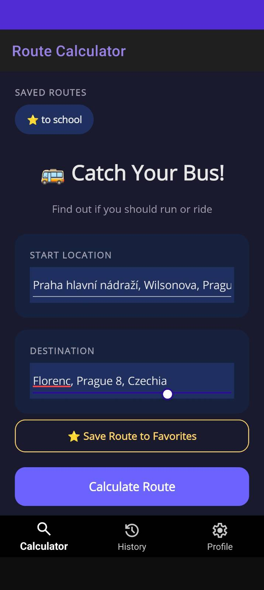
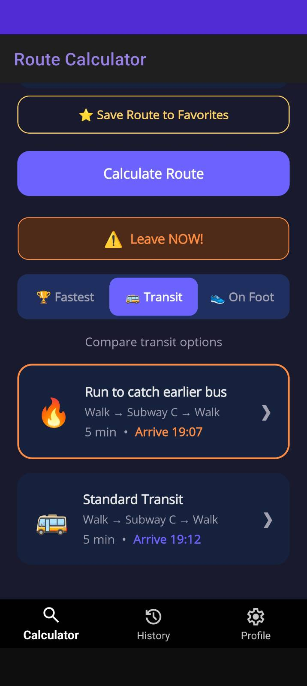
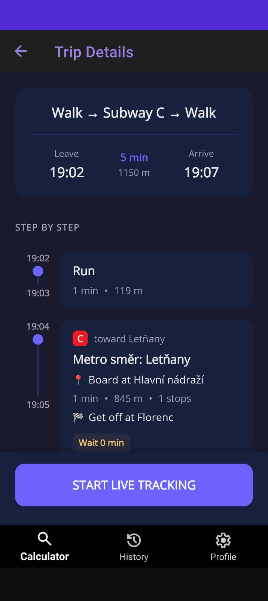
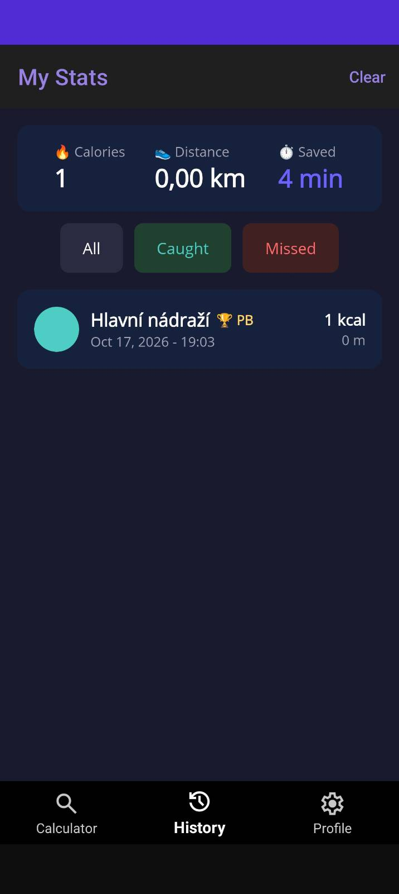
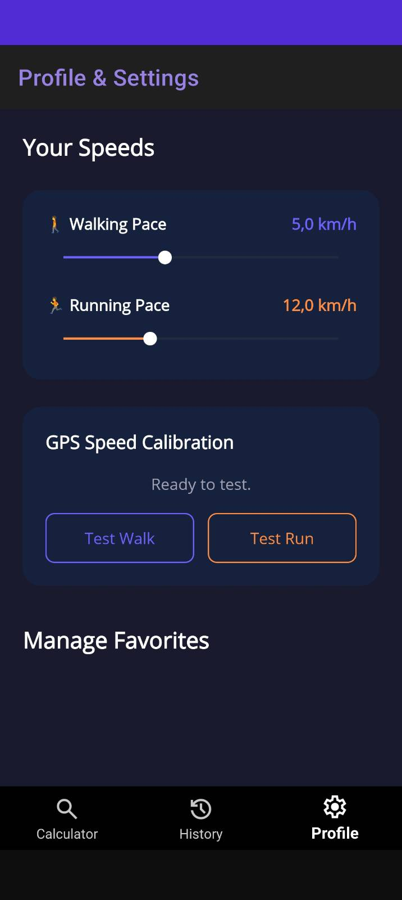

# Catch your bus!

MAUI application for commuters to find their ideal route to their destination :).

## Screenshots

| Route search | Route options | Trip details |
|:---:|:---:|:---:|
|  |  |  |

| History | Profile & settings |
|:---:|:---:|
|  |  |

## How to Run

### Prerequisites
* Android Emulator or a physical Android device.

### Config
Copy `Catch-your-bus/Config.example.cs` to `Catch-your-bus/Config.cs` (gitignored) and add your own Google Api Key.
 - the Google Api Key should have access to Routes API and Places (NEW) API